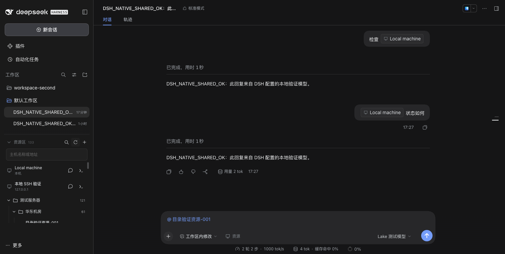

# DSH Lake 0.3.3

把 Lake 的资源与执行能力融入 DSH：在左侧工作区列表下方增加 **资源区**，在原生输入框中通过 **@资源** 选择主机，手动终端位于底部。会话、模型、消息、草稿、附件、权限和命令审批继续使用 DSH。



## 本地安装

在 DSH「插件 → 添加插件」中填入：

```text
/absolute/path/to/dsh-lake
```

0.3.3 新增后端管理接口，目录安装或更新后需完全退出并重新启动 DSH。原来独立的 Lake 导航入口和中间资源栏已移除，资源区出现在 DSH 原有侧栏中。

预构建包：`dist/clean-lakes-dsh-lake-0.3.3.tgz`，当前包含已签名的 **macOS Apple Silicon** 后端，验证宿主为官方 DSH `0.2.1-rc.2`。CLI/Web 安装：

```sh
dsh plugin --profile web add /absolute/path/to/clean-lakes-dsh-lake-0.3.3.tgz
dsh web
```

本机 CLI 若未加入 PATH，可使用 `/Applications/DeepSeek Harness.app/Contents/Resources/runtime/cli/bin/dsh`。桌面端使用其插件管理器安装本地目录；不要用 CLI 改写正在运行的 desktop profile。项目尚未发布 npm 包。

## 使用

1. 在 DSH 创建或选择工作区，在 DSH 设置中连接模型。
2. 左侧「资源区」跟随当前会话所属工作区，直接显示原有资源目录；点击目录展开/收起，搜索会保留匹配资源的目录路径。首次点击「启用资源区」，会建立该工作区的资源分组并提供本机终端；也可以选择「关联已有资源」，继续使用 0.2 创建的 Lake 资源项目。
3. 点击资源区的目录加号新建目录，点击「+」添加 SSH 主机并选择所属目录。目录右侧「⋯」支持新建子目录、添加主机、查看、重命名、移动和删除；删除目录会把其资源与子目录移到上一级。
4. 点击资源名称或右侧「⋯」查看连接详情。SSH 终端支持编辑名称、地址、端口、用户、Shell、登录方式和凭据，以及移动和删除。密码/私钥口令留空保留原值，替换私钥选择新文件。更改连接配置或删除前须先关闭该资源的所有终端。本机入口支持改名和修改 Shell，按 Lake 规则不能删除或移动。首次连接或指纹变化仍需明确核对服务器指纹。
5. 在 DSH 原生输入框输入 `@`，按名称或地址搜索当前工作区资源，选择后显示主机名标签。也可点击输入框「资源」按钮或侧栏资源旁的引用按钮。
6. 标签保留在原生草稿中，刷新后可恢复。发送时查询当前资源信息，将资源 ID、工作区 ID、类型和主机地址传给模型，不发送密码、私钥或凭据路径。失效引用会阻止发送并要求重新选择。
7. 模型通过 `lake_resources` 查询资源，通过 `lake_run_command` 请求执行命令。命令先经过 DSH「允许一次 / 拒绝」审批，Lake 的危险命令校验仍生效。
8. 点击资源旁的终端图标打开底部手动 Shell。同一工作区内切换 DSH 会话保留连接；切换工作区或关闭终端会断开连接。侧栏收起时，通过资源图标或输入框按钮访问资源。

资源区不再显示额外的工作区下拉框，切换工作区使用 DSH 原有导航。不同工作区默认建立独立资源分组；如果明确关联到同一个已有 Lake 项目，则共享该项目的资源。

## 能力落点

| Lake 能力 | DSH 中的位置 |
| --- | --- |
| 项目与主机资源 | 左侧工作区列表下方的资源区，按 DSH 工作区持久关联 |
| 目录和终端管理 | 资源区的目录加号、主机加号及每一行的「⋯」 |
| 资源搜索与引用 | 原生 `@` 候选菜单、输入框资源按钮、原生引用标签 |
| 手动本机/SSH Shell | 底部终端；其他插件占用底部时使用独立浮动终端 |
| Agent 资源查询与命令 | DSH 原生工具调用、审批和结果 |
| 模型与人工对话 | DSH 自身的模型设置、会话树和输入框 |

当前集成通过宿主公开的 `sidebar.footer.action`、`conversation.input.left`、`shell.bottom`、`shell.overlay` 和输入引用接口实现。DSH 0.2.1-rc.2 尚未提供每个工作区树节点下方的可追加子区，所以资源区位于工作区列表下方，并跟随当前工作区切换。插件不替换侧栏、会话树或主对话组件，也不修改宿主 DOM。

当前已拆入目录增删改查、终端资源增删改查、搜索/@引用、本机/SSH 终端及审批执行。数据库/Redis/Docker 连接配置编辑、文件、SRE 协作、策略、工作流和记忆管理页面仍未完成原生迁移，不能宣称与独立 Lake 全功能等同。

## 来源与数据

后端来自 [Lake develop](https://github.com/Clean-Lakes/Lake/tree/develop) 提交 `89a02c6c85d972c70579a14e238bac80be281fbb`，版本 0.3.21。上游开发分支名是 `develop`，没有 `dev`；`upstream/lake` 保留完整未修改源码，1630 个 Git blob 由 `npm run verify:source` 校验。

资源、SSH 凭据、服务器信任和终端记录存放在 `$DSH_HOME/storages/lake`，默认 `~/.dsh/storages/lake`。模型和人工消息留在 DSH。`dsh-workspace-projects.json` 保存工作区资源关联，`dsh-terminal-scopes.json` 保存内部终端范围；手动终端范围属于工作区，Agent 命令范围属于 DSH 会话。

0.1/0.2 的旧 Lake 资源和历史保留，不自动复制模型密钥或导入聊天。卸载插件保留数据。禁止使用 `~/.lake`、`~/.lake-dev` 或其子目录/符号链接作为插件 home。

插件 API 先验证 DSH 登录和同源请求，再使用服务端私有的 Lake bearer；浏览器不能调用原版 Lake 模型/聊天 API。后端使用独立数据锁和随机 loopback 端口。相同工具 call ID 在当前插件进程内复用结果；超时标为 unknown，不自动重放。

可以在宿主 profile 的 `cordis.patch.yml` 配置：

```yaml
- id: lake
  config:
    home: /absolute/path/to/private-dsh-lake
    startupTimeoutMs: 30000
    # binaryPath: /absolute/path/to/same-version/lake
```

## 构建与验证

需要 Node 24.x、pnpm 10.33.4、Go 1.26.6。macOS 后端完整构建使用上游持久签名身份，配置见 `upstream/lake/CONTRIBUTING.md`。

```sh
pnpm install --frozen-lockfile
npm run build:client
npm run verify:source
npm test
npm run test:integration
npm run build
npm pack --pack-destination dist
```

使用预构建包无需构建工具。其他平台需要对应平台构建与验收。验证记录见 [docs/validation.md](docs/validation.md)；历史 0.2 验收见 [docs/validation-0.2.md](docs/validation-0.2.md)。Apache-2.0、Lake 第三方声明和 xterm MIT 许可随包保留。
